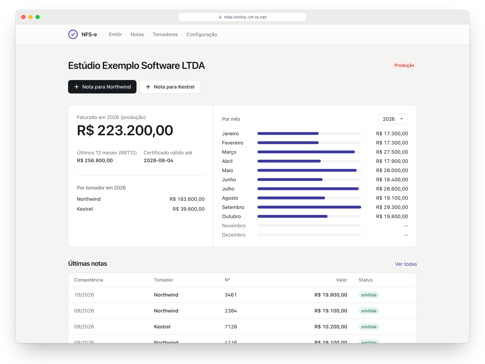
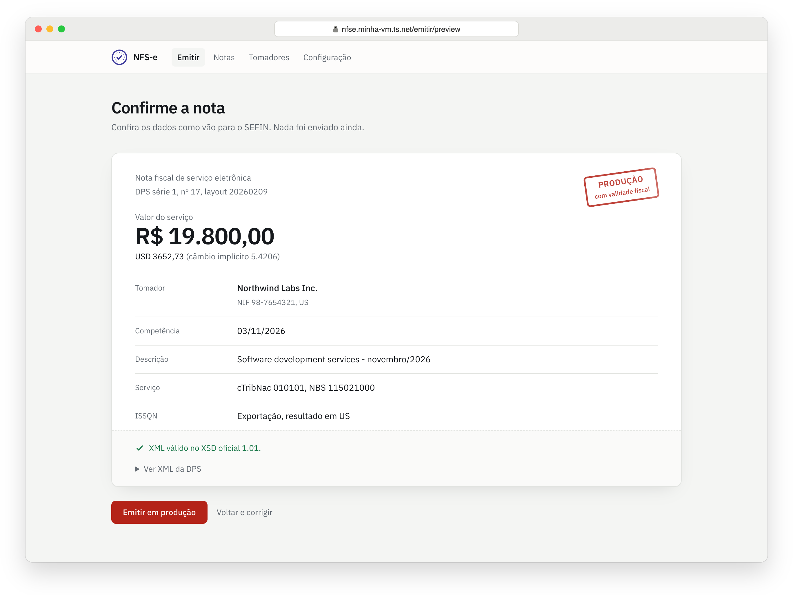
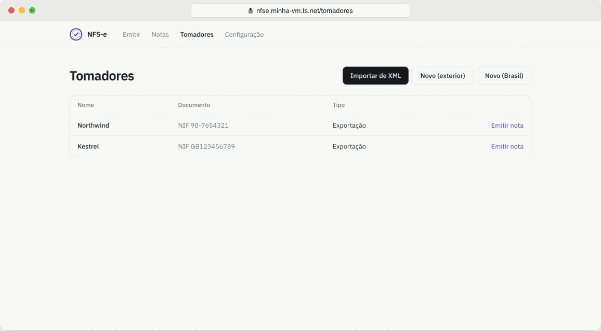
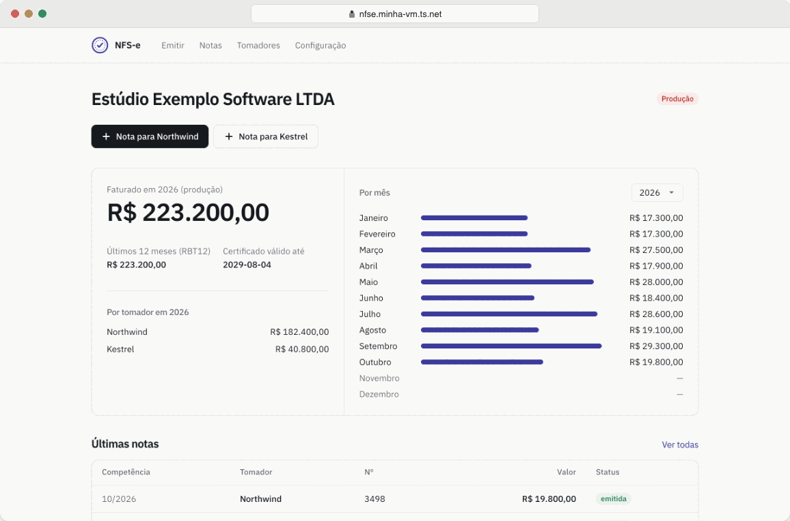

<div align="center">

# NFS-e

**Emissor próprio de NFS-e pela API oficial do SEFIN Nacional, com o seu certificado A1.**

Feito para PJ que fatura todo mês para os mesmos clientes, inclusive no exterior.

[](https://python.org)
[](https://fastapi.tiangolo.com)
[](https://tailwindcss.com)
[](https://sqlite.org)
[](LICENSE)

[Primeiro uso](#primeiro-uso-ordem-importa) · [Rodar local](#rodar-local) · [Deploy](#deploy-numa-vm-linux) · [Segurança](#segurança)



</div>

---

Cadastro de tomadores com "molde" fiscal, emissão em 2 cliques, histórico, totais por mês,
RBT12, CSV, XML e PDF (DANFSe).

Stack: FastAPI + SQLite + Jinja + Tailwind v4. A DPS é montada por `app/dps.py` (cobre tomador
estrangeiro, exportação e comércio exterior, que as libs prontas não cobrem) e validada contra o
XSD oficial 1.01. A assinatura XMLDSIG e o transporte mTLS vêm da `PyNFSeNacionalGT`.

Antes de enviar, a nota aparece como vai para o SEFIN, já validada no XSD e com o ambiente
carimbado: produção tem validade fiscal, homologação é só teste.



<sub>Prints e GIFs com dados fictícios, em modo mock e com certificado autoassinado.</sub>

## Primeiro uso (ordem importa)

1. Em *Configuração → Certificado A1*, **envie o seu certificado** (arquivo `.pfx`/`.p12` do e-CNPJ) e a
   senha dele. O app só grava se o arquivo abrir com essa senha e mostra titular, validade e origem.
2. **Importe o XML de uma nota que você já emitiu** (Emissor Nacional → Notas Emitidas → baixar XML)
   em *Tomadores → Importar de XML*. Isso cria o tomador com exatamente os códigos, a tributação e o
   grupo de comércio exterior da nota que já foi aceita, e preenche sua empresa.

   

3. Em *Configuração*, confira CNPJ, município e regime. O ambiente começa em **Homologação**.
4. Emita uma nota de teste. Ela vai para a *produção restrita* (sem validade jurídica).
   Se vier rejeição, a mensagem do SEFIN (código E0xxx) aparece na tela; ajuste o molde do tomador.
5. Quando o teste passar, mude para **Produção** em *Configuração* (exige marcar a confirmação).

A partir daí, cada mês é: botão "+ Nota para X" → valor → revisar → emitir. Para tomador no exterior,
preencha o valor em reais ou na moeda estrangeira: o outro campo é convertido sozinho pela PTAX de compra
do Banco Central (último fechamento até a data de competência). Só a moeda e a data vão para o BCB.



Quando faltarem 90 dias ou menos para o certificado vencer, o painel e a tela *Configuração* mostram um aviso.
Renovou? Envie o novo `.pfx` pela mesma tela: ele substitui o anterior na hora, sem reiniciar.
A tela também avisa se o CNPJ do certificado for diferente do CNPJ configurado da sua empresa.

## Segurança

- A emissão tem uma tela de revisão, com token de uso único: dar F5 ou clicar duas vezes não gera duas notas.
- Antes de enviar, o app consulta se aquela DPS já virou nota (`HEAD /dps/{id}`). Se um envio
  anterior caiu no meio, ele recupera a nota em vez de duplicar.
- **Certificado e senha ficam fora do banco**, em arquivos na pasta de dados (`data/` no Docker):
  - Enviado pela interface: `data/certificado.pfx` e a senha em `data/certificado.senha`, ambos com
    permissão `0600`, gravados de forma atômica com nome fixo (o nome do arquivo enviado é ignorado).
    Um envio novo substitui o anterior; se `NFSE_CERT_PATH` apontava para outro `.pfx` dentro de
    `data/`, esse arquivo antigo é apagado. A senha nunca vai para log, tela, resposta ou mensagem de erro.
  - *Trade-off*: a senha precisa sobreviver a reinícios, então fica em texto puro ao lado do
    certificado, protegida só pela permissão do arquivo. É o mesmo nível de proteção de antes (o
    `.env` com a senha também ficava em disco), mas agora **quem tiver uma cópia de `data/` tem o
    certificado e a senha**: trate backups dessa pasta como você trataria o próprio `.pfx`. Ficar
    fora do SQLite evita que a senha vá junto em cópias do banco.
  - Compatibilidade: `NFSE_CERT_PATH`/`NFSE_CERT_SENHA` continuam funcionando. Se existir um
    certificado enviado pela interface, **ele tem prioridade** sobre as variáveis (a tela *Configuração*
    mostra qual está em uso). Para voltar às variáveis, apague `data/certificado.senha`
    (e confira se `NFSE_CERT_PATH` aponta para um `.pfx` que ainda existe).
- **O app não tem login.** Quem alcançar a porta consegue emitir notas com o seu certificado.
  Por isso o `docker-compose.yml` publica só em `127.0.0.1`. **Nunca exponha a porta na internet.**
  Para acessar de outro aparelho, use uma rede privada (o jeito mais simples é o Tailscale, abaixo)
  ou coloque um proxy reverso com autenticação na frente.
- **Outros sites não conseguem agir pelo seu navegador** (`app/seguranca.py`):
  - *CSRF*: todo POST com `Origin` (ou, na falta dele, `Referer`) de outro host, com `Origin: null`
    ou com `Sec-Fetch-Site: cross-site` é recusado com 403. POST sem nenhum desses cabeçalhos passa,
    porque só clientes que não são navegador (curl, scripts) mandam assim, e eles não servem para CSRF.
  - *DNS rebinding*: só são aceitos os hosts de `ALLOWED_HOSTS` (padrão: `localhost,127.0.0.1,[::1]`).
    Qualquer outro `Host` recebe 400, inclusive em GET. Só o `/healthz` fica de fora.
  - Atrás de proxy/Tailscale: o `Origin` precisa bater com o `Host` ou com o `X-Forwarded-Host`
    (este só vale se também estiver em `ALLOWED_HOSTS`). Assim funciona tanto com proxy que preserva o
    `Host` quanto com proxy que o reescreve para `127.0.0.1:8000`. Em qualquer caso, **coloque o
    hostname público em `ALLOWED_HOSTS`**. Prefira um proxy que preserve o `Host`: se ele reescreve
    o `Host` para `127.0.0.1`, a allowlist deixa de proteger o que chega pelo proxy.

> **Atualizando de uma versão anterior?** Se você acessa por Tailscale ou proxy reverso, adicione o
> hostname ao `.env` antes de subir a versão nova, senão toda página responde
> *400 Host não permitido* (a mensagem diz qual nome incluir):
> `ALLOWED_HOSTS=localhost,127.0.0.1,[::1],<nome-da-vm>.<tailnet>.ts.net`

## Rodar local

```bash
cp .env.example .env    # opcional: tudo tem padrão
docker compose up -d --build     # http://127.0.0.1:8000 → Configuração → envie o certificado
```

Sem Docker: `pip install -r requirements.txt && uvicorn app.main:app` (use as mesmas variáveis).
Testes: `pip install pytest httpx && pytest -q` (rodam em modo mock, sem tocar no governo).

CSS: Tailwind v4. O `app/static/app.css` compilado vai no repositório (o Docker não precisa de Node).
Depois de mexer nos templates ou em `app/static/tailwind.css`, recompile com o
[CLI standalone](https://github.com/tailwindlabs/tailwindcss/releases):
`tailwindcss -i app/static/tailwind.css -o app/static/app.css --minify`.

## Deploy numa VM Linux

```bash
# na VM (Debian/Ubuntu)
sudo apt-get update && sudo apt-get install -y docker.io docker-compose-v2
git clone https://github.com/assis-lucas/nfse-app.git nfse && cd nfse
cp .env.example .env && nano .env
mkdir -p data && chmod 700 data
sudo docker compose up -d --build         # depois, envie o .pfx em Configuração pelo navegador

# acesso privado pelo celular/notebook, sem abrir porta:
curl -fsSL https://tailscale.com/install.sh | sh && sudo tailscale up
sudo tailscale serve --bg 8000            # https://<nome-da-vm>.<tailnet>.ts.net
# libere esse nome no app: no .env,
#   ALLOWED_HOSTS=localhost,127.0.0.1,[::1],<nome-da-vm>.<tailnet>.ts.net
sudo docker compose up -d                 # recarrega o .env
```

Uma VM pequena (1 GB de RAM) dá conta com folga. Quer gastar zero? O [free tier do Google Cloud](https://docs.cloud.google.com/free/docs/free-cloud-features#compute)
inclui uma `e2-micro` (1 GB) por mês, de graça, desde que fique em `us-west1`, `us-central1` ou `us-east1`
e use disco *standard* de até 30 GB. Repare que essas regiões ficam nos EUA (veja o aviso sobre IP abaixo).
Faça backup de `data/` de vez em quando
(banco, certificado e senha: guarde o backup em lugar seguro).
Se o SEFIN recusar conexão vinda de IP fora do Brasil, use uma VM hospedada no Brasil
com os mesmos comandos.

## Estrutura

```
app/dps.py        montagem da DPS (layouts 20260209 e NT 009) + validação XSD
app/importer.py   lê XML de NFS-e/DPS → tomador, molde e nota
app/sefin.py      assinatura, envio, idempotência, modo mock, certificado (leitura e upload)
app/main.py       rotas/telas
app/seguranca.py  allowlist de Host (DNS rebinding) e checagem de Origin (CSRF)
app/db.py         modelos (valores em centavos)
app/templates/    telas (Jinja2 + Tailwind; fonte IBM Plex, OFL, em app/static/fonts)
```

## Limitações conhecidas

- Cancelamento ainda é feito no Emissor Nacional; depois é só marcar como cancelada no app.
- Só um prestador (a sua empresa). Quer emitir para vários CNPJs no mesmo app? Abre um Pull Request :)
  Enquanto isso, dá para rodar uma instância por empresa.
- A validação XSD local só cobre o layout de produção. No NT 009 (homologação), quem valida é o SEFIN.

## Licença

[MIT](LICENSE).
